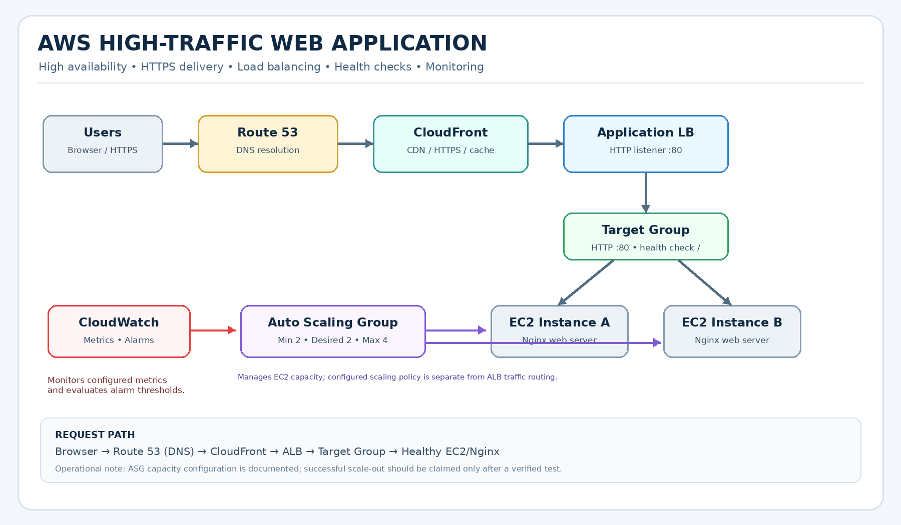

# 🚀 AWS High-Traffic Web Application

### A hands-on AWS infrastructure project focused on high availability, traffic distribution, HTTPS delivery, auto scaling configuration, and operational monitoring.

  <a href="https://techwithshiva.in"><strong>🌐 Live Application</strong></a>

  
  
  
  
  

---

## 📌 Project Overview

This project demonstrates how to deploy and operate an AWS-hosted web application using multiple infrastructure layers. It combines DNS resolution, content delivery, load balancing, EC2 instances, health checks, Auto Scaling configuration, and CloudWatch monitoring.

The goal is to understand how requests travel through the infrastructure, how unhealthy targets are detected, and how to troubleshoot real-world delivery and availability issues.

### 🎯 Key Objectives

- Configure a custom domain using Amazon Route 53.
- Deliver the application through Amazon CloudFront over HTTPS.
- Distribute incoming requests through an Application Load Balancer.
- Register EC2 instances in a target group and validate their health.
- Configure an Auto Scaling Group with a desired capacity of two instances.
- Configure CloudWatch alarms for infrastructure monitoring.
- Investigate stale CloudFront content and validate the fix.

---

## 🏗️ Architecture

### Request Flow

1. **User / Browser** — requests `https://techwithshiva.in`.
2. **Amazon Route 53** — resolves the custom domain to the CloudFront distribution.
3. **Amazon CloudFront** — handles HTTPS delivery and applies its configured caching behavior.
4. **Application Load Balancer** — receives forwarded requests and distributes traffic across registered targets.
5. **Target Group** — evaluates target health using the configured HTTP health check.
6. **Amazon EC2 + Nginx** — serves the web application.

### Supporting Infrastructure

- **Auto Scaling Group:** manages the EC2 fleet and its configured capacity.
- **Amazon CloudWatch:** monitors configured metrics and evaluates alarm thresholds.
- **AWS Certificate Manager:** provides the TLS certificate associated with HTTPS delivery.

---

## ☁️ AWS Services

| AWS Service | Role in the Project |
|---|---|
| Route 53 | Custom-domain DNS resolution |
| CloudFront | Content delivery, HTTPS entry point, caching |
| Application Load Balancer | Distributes incoming application traffic |
| Target Group | Registers instances and performs health checks |
| Amazon EC2 | Hosts the Nginx web application |
| EC2 Auto Scaling | Manages instance capacity |
| Amazon CloudWatch | Metrics and alarm evaluation |
| AWS Certificate Manager | TLS certificate management |

---

## ✅ Implementation & Validation

| Component | Validation |
|---|---|
| Custom domain | Application accessible at `https://techwithshiva.in` |
| ALB | Returns the updated application page |
| Target Group | Two healthy registered targets observed |
| Auto Scaling Group | Minimum: 2, Desired: 2, Maximum: 4 |
| CloudWatch | Monitoring alarms configured |
| CloudFront | Distribution configured to forward the default behavior to the ALB |

> **Validation note:** The configured Auto Scaling capacity does not alone prove that a scale-out event occurred successfully. A successful scaling test will be documented separately if verified.

---

## 🧰 Real-World Troubleshooting

### Issue: Old webpage returned through CloudFront

**Symptom:** The ALB returned the updated homepage, while the custom domain continued to return an older, cached response.

**Investigation:**
- Compared the ALB response with the CloudFront response.
- Inspected CloudFront origins and the default behavior.
- Reviewed cache headers and invalidation status.

**Resolution:** The updated webpage became visible after the CloudFront invalidation workflow was completed.

A detailed root-cause analysis, troubleshooting commands, and lessons learned will be maintained in the `troubleshooting/` directory.

---

## 📸 Project Evidence

Screenshots documenting the implementation will be maintained in [`evidence/`](evidence/README.md), including:

- Live application homepage
- CloudFront distribution
- Healthy target group
- Auto Scaling Group configuration
- CloudWatch alarms

---

## 📚 Documentation Roadmap

- `architecture/` — architecture diagram and request flow
- `docs/` — design decisions, configuration, and service explanations
- `troubleshooting/` — incidents, root-cause analysis, and resolutions
- `evidence/` — AWS Console and application screenshots
- `cheatsheets/` — useful AWS CLI commands and operational references

These documents will be added as the project documentation is completed.

---

## 🧠 Key Learnings

- Understanding the difference between DNS resolution and HTTP traffic routing
- Tracing requests through CloudFront, ALB, target groups, and EC2
- Validating target health and investigating unhealthy targets
- Understanding Auto Scaling capacity and scaling policies
- Troubleshooting cached content using response headers and invalidations
- Using CloudWatch alarms for operational visibility

---

## 👨‍💻 Author

**Cloud & Infrastructure Engineering Portfolio**

🌐 Live application: https://techwithshiva.in

